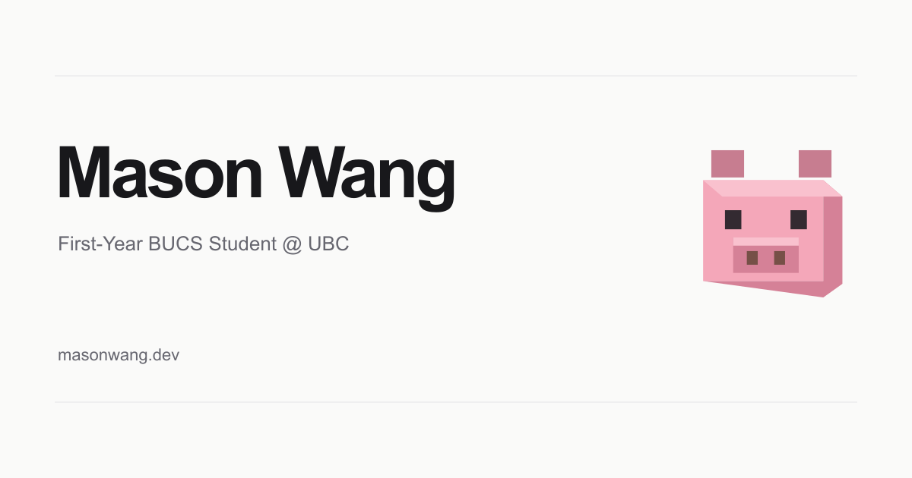

# Mason Wang

My personal portfolio website built with Next.js, React, and TypeScript.

Website: [masonwang.dev](https://masonwang.dev)

## Tech

Next.js 16, React 19, TypeScript, Tailwind CSS 4, Motion (Framer Motion), Three.js, React Three Fiber, Drei, and Rapier. Images use Next.js and Sharp. Fonts are self-hosted.

## Running locally

```sh
npm install
npm run dev
```

Open [localhost:3000](http://localhost:3000).

```sh
npm run lint
npm run build
npm start
```

## Notes

Content lives in `app/lib/portfolio.ts`. Photos live in `public/`; missing media is left out automatically. The Resume page previews `public/resume-preview-1.png` and downloads `public/resume.pdf`. Update both when replacing the résumé.

The pig game lives in a square window next to the intro, loads separately, pauses offscreen, and expands into a modal. Dark mode, reduced motion, keyboard navigation, and photo enlargement are supported.

Deploy to the existing Vercel project, `masonwang`. Production uses [masonwang.dev](https://masonwang.dev).

## Projects

- [Itemdle](https://masonwang.dev/projects/itemle/index.html): daily League item recipes, unlimited practice, victory effects, puzzle ranks, a stats panel (streaks and guess distribution), hard mode, and a next-daily countdown. [Builddle](https://masonwang.dev/projects/itemle/builddle.html) adds champion clues and missing-build-item challenges. Source: https://github.com/masonwng/league-itemle
- [Math Ascension](https://masonwang.dev/projects/math-ascension/index.html): fourteen stages from Kindergarten to University Year 1 drawn as a mountain climb, Standard, One-Life, and 60-second Time Attack modes, worked solutions, and saved progress. Source lives in `public/projects/math-ascension/`.

Run `node scripts/sync-projects.mjs` to copy the Itemdle runtime from the sibling `league-itemle` checkout before building. Math Ascension is maintained directly in this repository. The old Lane notes URL remains available for existing links but is no longer featured.

See [game architecture, data provenance, tests, and limitations](docs/GAMES.md). Builddle uses a small manually reviewed, dated question bank with U.GG source links and Riot metadata; it is not a live U.GG API integration.

The home page cards are playable: a one-guess Itemdle round and a six-question mini climb. A scoreboard under the projects reads each game's saved progress on the visitor's device. The farm has goals, eight achievements, and day/night lighting from the visitor's clock.

## Documentation

- [Architecture and content maintenance](docs/MAINTENANCE.md)
- [Social previews, deployment, and verification](docs/SHARING-AND-DEPLOYMENT.md)
- [Avatar generation and refinement prompts](docs/favicon-generation.md)
- [Release history](CHANGELOG.md)
- [Itemle documentation](https://github.com/masonwng/league-itemle#readme)
- [Games and verification](docs/GAMES.md)

## Sharing thumbnail



Regenerate this 1200 × 630 image with `npm run generate:social-preview`. Its shared Open Graph / Twitter configuration lives in `app/lib/social-preview.ts`; update the image URL's version after changing the artwork. Existing third-party shares may retain their cached preview until refreshed by that service.

## Design system

- **Type:** Bricolage Grotesque (display: headings, numerals, wordmark) and Instrument Sans (body and UI). Both are Latin subsets of the OFL variable fonts in `app/fonts/` (licences alongside), loaded with `next/font/local`. Bricolage is instanced at optical size 96 and width 88 with weight 500–800 to keep it around 31 KB.
- **Colour:** tokens live at the top of `app/globals.css`: cool paper `#f2f3f7`, ink `#14162b`, one accent (ultramarine `#4433ff`; periwinkle `#9c94ff` in dark mode). Every text/background pair meets WCAG AA in both themes. The theme follows the system setting until the visitor uses the toggle.
- **Texture:** a 2 KB tiled noise PNG (`public/grain.png`) and two soft accent washes behind the page.

## Interactions

All motion honours `prefers-reduced-motion`. Cursor-driven effects only run on a mouse or trackpad (`app/lib/pointer.ts`).

| Effect | Where | File |
| --- | --- | --- |
| Letter rise on load, letters lean toward the cursor | Hero name | `hero-name.tsx` (entrance is CSS) |
| Cursor spotlight, portrait parallax | Hero | `hero-stage.tsx` |
| Dot + trailing ring cursor, "play" label over project cards | Site-wide | `cursor.tsx` |
| Scramble/decode on hover and focus | Nav and footer links | `scramble-text.tsx` |
| Letter wave on hover | Section headings | `wave-text.tsx` + CSS |
| Sliding underline | Text links | CSS |
| Magnetic pull | CTAs, social icons, contact button | `magnetic.tsx` |
| 3D tilt, glare, lift, preview zoom | Itemdle and Math Ascension cards | `tilt-card.tsx` |
| Fade/slide in on scroll | `[data-reveal]` elements | `scroll-effects.tsx` + CSS |
| Count-up | Stats strip | `count-up.tsx` |
| Rail fill and items lighting up | "Now" list and /work | `timeline.tsx` |
| Reading-progress bar | Top of viewport | `scroll-progress.tsx` |
| "copied!" tag | Every copy-email button | `email-copy.tsx` |
| Route transitions | Each page (React `<ViewTransition>`) | `page-transition.tsx` + CSS |

Motion is loaded through `LazyMotion` with its features fetched after hydration (`motion-provider.tsx`), so pages render and paint before any animation code arrives.
