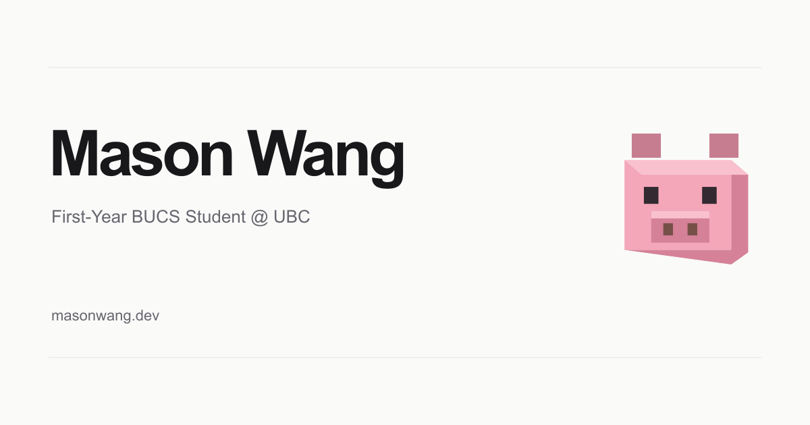

# Mason Wang

My personal portfolio website built with Next.js, React, and TypeScript.

Website: [masonwang.dev](https://masonwang.dev)

## Tech

Next.js 16, React 19, TypeScript, Tailwind CSS 4, Three.js, React Three Fiber, Drei, and Rapier. Images use Next.js and Sharp. Fonts are self-hosted.

## Running locally

```sh
npm install
npm run dev
```

Open [localhost:3000](http://localhost:3000).

```sh
npm run lint
npm run build
npm start
```

## Notes

Content lives in `app/lib/portfolio.ts`. Photos live in `public/`; missing media is left out automatically. The Resume page previews `public/resume-preview-1.png` and downloads `public/resume.pdf`. Update both when replacing the résumé.

The pig game lives in a square window next to the intro, loads separately, pauses offscreen, and expands into a modal. Dark mode, reduced motion, keyboard navigation, and photo enlargement are supported.

Deploy to the existing Vercel project, `masonwang`. Production uses [masonwang.dev](https://masonwang.dev).

## Projects

- [Itemdle](https://masonwang.dev/projects/itemle/index.html): daily League item recipes, unlimited practice, victory effects, and puzzle ranks. [Builddle](https://masonwang.dev/projects/itemle/builddle.html) adds champion clues and missing-build-item challenges. Source: https://github.com/masonwng/league-itemle
- [Math Ascension](https://masonwang.dev/projects/math-ascension/index.html): fourteen stages from Kindergarten to University Year 1, Standard and One-Life modes, worked solutions, and saved progress. Source lives in `public/projects/math-ascension/`.

Run `node scripts/sync-projects.mjs` to copy the Itemdle runtime from the sibling `league-itemle` checkout before building. Math Ascension is maintained directly in this repository. The old Lane notes URL remains available for existing links but is no longer featured.

See [game architecture, data provenance, tests, and limitations](docs/GAMES.md). Builddle uses a small manually reviewed, dated question bank with U.GG source links and Riot metadata; it is not a live U.GG API integration.

## Documentation

- [Architecture and content maintenance](docs/MAINTENANCE.md)
- [Social previews, deployment, and verification](docs/SHARING-AND-DEPLOYMENT.md)
- [Avatar generation and refinement prompts](docs/favicon-generation.md)
- [Release history](CHANGELOG.md)
- [Itemle documentation](https://github.com/masonwng/league-itemle#readme)
- [Games and verification](docs/GAMES.md)

## Sharing thumbnail



Regenerate this 1200 × 630 image with `npm run generate:social-preview`. Its shared Open Graph / Twitter configuration lives in `app/lib/social-preview.ts`; update the image URL's version after changing the artwork. Existing third-party shares may retain their cached preview until refreshed by that service.
